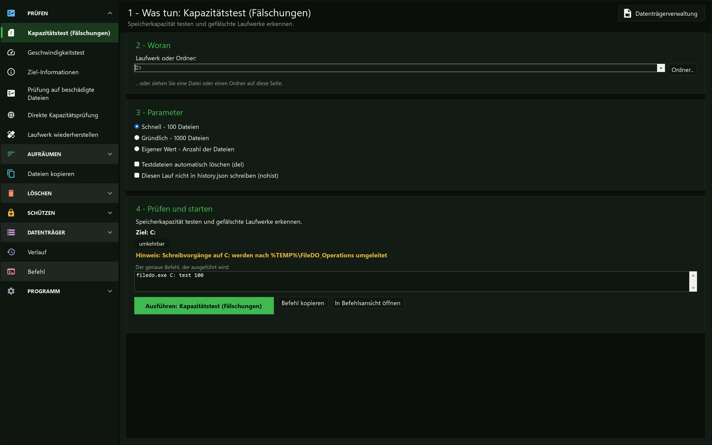

# FileDO - Prüfen Sie Ihren Speicher, bevor Sie ihm vertrauen

<div align="center">

[](https://goreportcard.com/report/github.com/SerZhyAle/FileDO)
[](https://opensource.org/licenses/MIT)
[](https://github.com/SerZhyAle/FileDO)
[](https://github.com/SerZhyAle/FileDO)

**Test auf gefälschte Kapazität • Geschwindigkeitstest • Duplikate finden • Ordner vergleichen • Freien Speicher löschen • Dateien mit Passwort schützen • Virtuelle Datenträger**



</div>

---

## Schnellstart

### Häufigste Aufgaben

```bash
# USB/SD-Karte auf Fälschung prüfen
filedo E: test del

# Festplatten-Leistungstest
filedo C: speed 100

# Freien Speicherplatz überschreiben
filedo D: fill 1000 del

# Duplikate suchen und verwalten
filedo C: check-duplicates
filedo D:\Photos cd old del

# Kopieren mit Fortschrittsanzeige
filedo folder C:\Source copy D:\Backup
filedo device E: copy F:\Archive
# Erst den Baum zählen, für eine genaue Restzeit (sonst beginnt das Kopieren mit der ersten Datei)
filedo folder C:\Source copy D:\Backup --precount

# Schnelle Ordnerreinigung
filedo folder C:\Temp wipe
filedo folder D:\Cache w

# Festplatten-Informationen anzeigen
filedo C: info
```

### Lese-Check (check)

`filedo check <Ordner>` liest die Dateien und markiert eine Datei als beschädigt, die langsam (> 2,0 s) oder mit einem Gerätefehler gelesen wird. Die Listen beschädigter und gut gelesener Dateien liegen in `%LOCALAPPDATA%\FileDO\state` und benennen eine Datei über Pfad, Größe, Änderungszeit sowie das Volume und die Datei, auf denen sie erfasst wurde: eine geänderte Datei oder eine Kopie unter demselben Pfad auf einer anderen Karte mit demselben Laufwerksbuchstaben wird erneut gelesen; Einträge älterer Versionen ohne Volume gelten nicht. Eine reine Online-Datei (ein Platzhalter von OneDrive oder einer anderen Cloud, oder eine Offline-Datei) wird nie geöffnet - weder beim Durchlauf noch wenn genau sie geprüft wird -, also wird nichts heruntergeladen. Sie zählt als `not-read(online-only)`, wird nie als beschädigt erfasst und macht den Lauf zu „konnte nicht prüfen“ (Code 2), sofern keine beschädigte Datei gefunden wurde (Code 1).

### Installation

#### Variante 1 - winget

```powershell
winget install SerZhyAle.FileDO
```

Installiert die Kommandozeilenwerkzeuge (`filedo`, `filedo_check`, `filedo_fill`, `filedo_test`) und das grafische Fenster `filedo_win` (eine Seite je Aufgabe) und nimmt sie in den `PATH` auf.

Auch im [Microsoft Store](https://apps.microsoft.com/detail/9PH1LPCMRG83) erhältlich - dieselben Werkzeuge, Installation und Updates übernimmt der Store.

#### Variante 2 - Installationsprogramm (Setup-EXE)

`FileDO-<Version>-setup.exe` aus den [Releases](https://github.com/SerZhyAle/FileDO/releases/latest) herunterladen und ausführen. Erst damit wird FileDO ein gewöhnliches Windows-Programm und nicht bloß ein Ordner voller Programmdateien:

- legt die Dateien nach `C:\Program Files\FileDO` und nimmt `filedo` in den System-`PATH` auf;
- erstellt einen **Startmenü-Eintrag** und ein **Desktop-Symbol** für das FileDO-Fenster (`filedo_win.exe`) und einen zweiten Startmenü-Eintrag, **FileDO Disk Manager**, der die Datenträgerverwaltung gleich öffnet (`filedo_win.exe --disks`);
- registriert die **Explorer-Integration**: eine Gruppe `File DO..` im Kontextmenü jeder Datei - Secure (Original behalten, löschen oder überschreiben, oder ein zufälliger Containername), Unsecure (optional den Container löschen oder die wiederhergestellte Datei sofort starten), Wipe this file, Check this file, Info - dazu den Dokumenttyp `.fd-sec` mit eigenem Symbol: der Doppelklick ist genau der Eintrag Unsecure and start: eine Konsole fragt dort das Kennwort ab, stellt das Original unter seinem echten Namen in `%LOCALAPPDATA%\FileDO\reveal` wieder her - einem Ordner, den nur dieses Konto und das System lesen können -, übergibt es dem Programm, dem seine echte Erweiterung gehört, und entfernt diese Kopie wieder, sobald das Konsolenfenster geschlossen wird. Unter Windows 11 steht die Gruppe unter *Weitere Optionen anzeigen*;
- registriert den **Dateityp `.fdd` der Datenträger-Container** (Feature *Disk container files (.fdd)*): ein eigenes Symbol, einen Doppelklick, der das FileDO-Fenster öffnet und den virtuellen Datenträger einbindet, und *Mount read-only* und *Unmount* im Kontextmenü - siehe den Abschnitt *Virtuelle Datenträger* weiter unten.

Das Installationsprogramm ist nicht code-signiert; deshalb zeigt Windows beim ersten Start möglicherweise *Der Computer wurde durch Windows geschützt* und fragt danach nach Administratorrechten. Die SHA256 vergleichen (die `.sha256`-Datei liegt neben dem Download; `certutil -hashfile FileDO-<Version>-setup.exe SHA256`) und dann *Weitere Informationen* und *Trotzdem ausführen* wählen. Warum die Warnung erscheint, wofür die Administratorrechte verwendet werden und was FileDO niemals tut: [Windows warned you about FileDO](https://serzhyale.github.io/FileDO/guides/install-trust.html) (Seite auf EN/RU/UA).

Die drei letzten Punkte sind Features, die sich auf der Seite „Choose what to install" abwählen und später über **Ändern** in „Apps & Features" ein- oder ausschalten lassen. Unbeaufsichtigt:

```powershell
FileDO-<Version>-setup.exe /quiet
FileDO-<Version>-setup.exe /uninstall
```

Dasselbe Release veröffentlicht auch die blanke `FileDO-<Version>-windows-x64.msi` - genau diese Datei steckt in der Setup-EXE - für Verteilwerkzeuge, die Paket und Feature-Namen direkt brauchen:

```powershell
msiexec /i FileDO-<Version>-windows-x64.msi /qn ADDLOCAL=Main,ExplorerIntegration,DiskContainerIntegration,DesktopShortcut
msiexec /i FileDO-<Version>-windows-x64.msi /qn ADDLOCAL=Main   # ohne Explorer-Einträge, ohne .fdd-Typ, ohne Desktop-Symbol
```

Das Deinstallieren entfernt alles, was das Installationsprogramm geschrieben hat, die Registrierungseinträge eingeschlossen.

#### Variante 3 - Microsoft Store (MSIX)

Ein Paket, zwei Einstiege: die anklickbare Kachel **FileDO** und der Befehl `filedo` im `PATH`. Die Store-Version hat die Explorer-Einträge **nicht**: ein Paket bekommt sie nur über einen signierten Shell-Handler, und das ist eigene Arbeit. Den Dateityp `.fd-sec` beansprucht sie **doch**: ein Doppelklick auf einen Container öffnet das FileDO-Fenster auf der Seite *Geheime Datei öffnen* mit diesem Container bereits ausgewählt, und dort wird nach dem Passwort gefragt. Auch den Typ `.fdd` beansprucht sie, doch die Store-Version kann keine virtuellen Datenträger einbinden: ein Doppelklick öffnet das FileDO-Fenster auf diesem Container, wo er sich lesen, prüfen und exportieren lässt - siehe den Abschnitt *Virtuelle Datenträger* weiter unten.

#### Variante 4 - Manueller Download

1. **Herunterladen**: `FileDO-<Version>-windows-x64.zip` aus den Releases beziehen und beliebig entpacken
2. **GUI**: `filedo_win.exe` liegt im Archiv - neben `filedo.exe` starten
3. **Ausführung**: Über Kommandozeile oder GUI starten

#### Explorer-Integration ohne Installationsprogramm

winget, das portable Archiv und `go install` führen kein Installationsprogramm aus und registrieren deshalb nichts. Dieselbe Gruppe und derselbe Dokumenttyp lassen sich selbst anfordern - und ebenso zurücknehmen:

```powershell
filedo fdsec register              # für diesen Benutzer
filedo fdsec register -all-users   # für den ganzen Rechner (erhöhte Konsole nötig)
filedo fdsec unregister            # entfernt genau das Geschriebene
```

FileDO entfernt nur, was es selbst markiert hat: ein Dokumenttyp, der inzwischen einem anderen Programm gehört, bleibt unangetastet, und wer `.fd-sec` vor FileDO besaß, bekommt es zurück.

---

## Hauptoperationen

<table>
<tr>
<td width="50%">

### Geräte-Tests
```bash
# Informationen
filedo C: info
filedo D: short

# Fake-Kapazität-Erkennung
filedo E: test
filedo F: test del

# Leistungstest
filedo C: speed 100
filedo D: speed max
```

</td>
<td width="50%">

### Datei- und Ordner-Operationen
```bash
# Ordner-Analyse
filedo C:\temp info
filedo . short

# Leistungstest
filedo C:\data speed 100
filedo folder . speed max

# Netzwerk-Operationen
filedo \\server\share test
filedo network \\nas\backup speed 100

# Stapelverarbeitung
filedo from commands.txt
filedo batch script.lst

# Bereinigung
filedo C:\temp clean
```

</td>
</tr>
</table>

---

## Geheime Dateien (`.fd-sec`)

Eine Datei - oder ein Ordner, sein ganzer Baum - geht in einen Container, hinter ein Passwort, und kommt
wieder heraus - von der Befehlszeile, aus dem Explorer-Menü oder von den Seiten der Gruppe **Schützen**
im Fenster. Der wahre Name des Originals, seine tatsächliche Größe und seine Zeitstempel sind darin
versiegelt, bei einem Ordner auch Pfad, Größe und Zeitstempel jedes Eintrags; der Container selbst
verrät nur seine eigene Größe, seinen sichtbaren Namen und seine Zeitstempel (`rename` erzeugt einen
namenlosen Datenblock). Auf der Platte ist ein Ordner-Container von einem Datei-Container nicht zu
unterscheiden.

```bash
# Einpacken (das Passwort wird zweimal abgefragt, ohne Anzeige)
filedo report.docx secure

# Einpacken und das Original loswerden - wiederherstellbar und die härtere Art
filedo report.docx secure del p:hunter2
filedo report.docx secure wipe p:hunter2

# Unter dem versiegelten Namen oder in diesen Ordner zurückholen
filedo report.fd-sec unsecure
filedo report.fd-sec unsecure here

# Im zugehörigen Programm öffnen, ohne auszupacken
filedo report.fd-sec reveal

# Ein Ordner wird genauso zu einer Datei und kommt als ganzer Baum zurück
filedo "Steuer 2025" secure
filedo "Steuer 2025.fd-sec" unsecure to D:\Restored

# Die leise Suite: ein härterer Schlüssel, keine Spur von Ausrichtung - aber nur FileDO öffnet sie
filedo report.docx secure suite2
```

Ein Ordner wird vollständig eingepackt - leere Unterordner eingeschlossen - und vollständig
wiederhergestellt: zuerst in einen frischen temporären Ordner, an seinen Platz verschoben erst, nachdem
jede Datei geprüft ist, und nie in oder über einen Ordner, der schon existiert (mit `-y` unter einem Namen
mit Zahlensuffix). Ein Ordner mit einer Junction, einer symbolischen Verknüpfung oder einem
Bereitstellungspunkt wird abgelehnt statt verfolgt. `del` und `wipe` entfernen den Originalbaum erst,
nachdem der Container zurückgelesen wurde, und nur, wenn sich der Ordner seit dem Einpacken nicht geändert
hat. `reveal` öffnet eine Datei, lehnt einen Ordner-Container also ab und verweist auf `unsecure`.

`suite2` versiegelt eine Datei (keinen Ordner) mit Suite 2 statt der Standard-Suite 1: ein mit Pepper
gefalteter Argon2id-Schlüssel mit 256 MiB und XChaCha20-Poly1305 in 64-KiB-Frames, sodass die Datei ab dem
ersten Byte Rauschen ist, ohne auch nur das 512-Byte-Clusterlängenmuster von Suite 1. Sie bewahrt den wahren
Namen, die tatsächliche Größe und den Zeitpunkt der Verschlüsselung, aber nicht die eigenen Zeitstempel des
Originals - die wiederhergestellte Datei erhält die aktuelle Zeit. Nur FileDO ab dieser Version öffnet sie:
ältere FileDO-Builds melden sie als beschädigt oder als falsches Passwort, und FastMediaSorter-Apps können
sie nicht öffnen, deshalb bleibt Suite 1 der Standard. `unsecure`, `reveal`, `fdsec info` und `fdsec verify`
erkennen die Suite selbst; sonst ändert sich nichts, und ein leeres Passwort bleibt reine Verschleierung.

Fünf Dinge klar gesagt, denn eine Sicherheitsfunktion, die sich überschätzt, ist schlimmer als gar keine:

- **Ein leeres Passwort ist nur Verschleierung - keine Geheimhaltung.** Es wird angenommen, und jede
  Oberfläche, die ein Passwort entgegennimmt, sagt schon beim Tippen, was es wert ist.
- **`wipe` senkt die Chancen auf Wiederherstellung und verspricht nichts.** Auf SSDs und auf
  Copy-on-Write- oder journalisierenden Dateisystemen garantiert das Überschreiben an Ort und Stelle
  nicht, dass die alten Blöcke weg sind.
- **`wipe` überschreibt nie eine Datei, die noch einen weiteren Hardlink hat.** Das Überschreiben an Ort
  und Stelle erreicht jeden Namen der Datei; deshalb bleibt das Original erhalten, und der Lauf sagt es.
  Entfernen Sie zuerst die überzähligen Links oder nehmen Sie `del`.
- **Eine geöffnete Kopie liegt in `%LOCALAPPDATA%\FileDO\reveal`**, schreibgeschützt und nur für dieses
  Konto und das System lesbar. Sie verschwindet, wenn Sie es sagen, oder wenn das öffnende Programm sie
  freigibt.
- **`unsecure start` - also der Doppelklick - legt seine Kopie in denselben geschützten Ordner**, nicht
  neben den Container, und entfernt sie beim Schließen des Konsolenfensters. Diese Kopie ist Ihre eigene
  Datei und keine schreibgeschützte Ansicht; hat das Programm sie in diesem Moment noch offen, räumt der
  nächste FileDO-Start sie weg. Dauerhaft zurück holt die Datei das schlichte `unsecure`.
- **Nach einem Stromausfall bleibt diese Kopie bis zum nächsten FileDO-Start liegen**, der sie entfernt.
  Sonst tut es nichts.

Es gibt keinen Wiederherstellungsschlüssel: ein vergessenes Passwort ist eine verlorene Datei. Das
Original bleibt erhalten, bis Sie es entfernen lassen, und nichts wird gelöscht, bevor der Container
geschrieben, zurückgelesen und geprüft ist. Programme und Skripte werden nie aus einem Container
gestartet - sie werden ausgepackt und ihr Ort wird angezeigt.

Im Fenster trägt die Gruppe **Schützen** dieselben drei Operationen als Seiten: das Passwort ist
verdeckt, wird beim Einpacken zweimal getippt und `filedo.exe` unsichtbar übergeben - es erreicht keine
Befehlszeile, keinen Laufbericht und keine Verlaufsdatei. Ein Doppelklick auf eine `.fd-sec` öffnet dieses
Fenster nicht - er führt **Unsecure and start** in der Konsole aus, genau wie der gleichnamige
Explorer-Menüeintrag.

---

## Sicherung und Wiederherstellung

Ein Ordner, ein ganzes Laufwerk oder eine Netzwerkfreigabe wandert in eine Datei - eine gewöhnliche
`.zip`, die jedes ZIP-Programm auf jedem Computer öffnet, oder diese ZIP-Datei, hinter einem Passwort in
einen `.fd-sec`-Container versiegelt - und kommt an ihre alte oder an eine neue Adresse zurück. Vor dem
Einpacken liest FileDO höchstens 10 Sekunden lang eine Stichprobe des Inhalts und wählt die
Kompressionsdichte selbst: Fotos und Videos werden unverändert abgelegt, Texte und Dokumente dichter
gepackt; die gewählte Stufe und die Dauer der Probe werden ausgegeben, und `level <0-9>` nennt die Dichte
stattdessen.

```bash
# D:\Photos-<yyMMddHHmm>.zip neben dem Ordner; jedes ZIP-Programm öffnet sie
filedo backup D:\Photos

# An einen anderen Ort, mit einer Dichte, die Sie nennen
filedo backup D:\Photos to E:\Bak level 9

# In Photos-<yyMMddHHmm>.fd-sec versiegelt (Passwort zweimal abgefragt); keep-zip behält die ZIP-Datei auch
filedo backup D:\Photos sec

# Ein Netzwerkordner genauso; ein ganzes Laufwerk braucht das Wort root und Ihr Ja nach der Größenschätzung
filedo backup \\nas\share\Docs
filedo backup E:\ root

# Den Ordner neben dem Archiv oder unter einer anderen Adresse wiederherstellen
filedo restore Photos-2611101530.zip
filedo restore Photos-2611101530.fd-sec to D:\
```

- **Die ZIP-Datei speichert den Namen des Ordners, nie seinen Pfad**, sodass eine gewöhnliche Sicherung,
  die Sie weitergeben, nicht zeigt, wie Ihr Datenträger aufgebaut ist. `restore` stellt den Ordner neben
  dem Archiv wieder her; `to <Ordner>` nennt jede andere Adresse, auch die ursprüngliche.
- **Nichts wird ergänzt oder ersetzt.** Ein Ordner, der am Ziel schon existiert, bleibt, wie er ist:
  `restore` bietet an, daneben als `<Name>-1` zu schreiben, und `suffix` antwortet in einem Stapellauf mit
  Ja. Auch ein vorhandener Archivname wird nie überschrieben.
- **Ein Archiv, dessen Eintragsnamen das Ziel verlassen würden** - `..`, ein absoluter Pfad, ein
  Laufwerksbuchstabe, ein Gerätename wie `CON` - wird als Ganzes abgelehnt, bevor etwas geschrieben wird.
- **Das Windows-Laufwerk selbst wird abgelehnt**; auf einem anderen ganzen Laufwerk werden die
  Auslagerungsdatei, die Ruhezustandsdatei und `System Volume Information` übersprungen, und der Lauf
  sagt das. Das Archiv wird nie in den Ordner geschrieben, den es einpackt.
- **Eine Verzweigung oder ein symbolischer Link in der Quelle lehnt die Sicherung ab** und nennt den
  Eintrag; `skip-links` lässt die Links weg und listet jeden einzelnen auf, sodass eine unvollständige
  Kopie nie unbemerkt bleibt.
- **Was mitkommt**: die Dateien, die leeren Ordner und die Änderungszeit jeder Datei. Berechtigungen,
  alternative Datenströme und Links nicht.
- **Ein angehaltener Lauf (Strg+C) hinterlässt kein Archiv** - nur fertige Dateien bekommen ihren
  endgültigen Namen. Eine versiegelte Sicherung mit falschem Passwort, eine Datei, die kein Container ist,
  und ein beschädigter Container enden in derselben Antwort, wie bei `unsecure`; `del` entfernt das Archiv
  nach einer gelungenen Wiederherstellung.
- **Eine Sicherung ist eine ganze Kopie, angelegt, wenn Sie sie starten** - es gibt keinen Zeitplan, keine
  Liste früherer Sicherungen und keine inkrementellen Schichten. Eine einzelne Datei kommt stattdessen mit
  `secure` in einen Container.

Im Fenster trägt die Gruppe **«Schützen»** beide Operationen als Seiten - **«Ordner sichern»** und **«Aus
Sicherung wiederherstellen»** -, und die Seite **«Befehl»** baut sie ebenfalls (`backup`, `backup sec`,
`restore`). Das Passwort wird verdeckt getippt (für eine versiegelte Sicherung zweimal) und erreicht keine
Befehlszeile.

---

## Virtuelle Datenträger (`.fdd`)

Ein Container ist eine gewöhnliche `.fdd`-Datei, die ein ganzes Volume enthält. Eingebunden ist er ein
Laufwerksbuchstabe wie jeder andere; nicht eingebunden ist er eine Datei, die Sie kopieren, sichern oder
allein mit FileDO lesen können, ohne ihn einzubinden. Das Format ist vollständig als Vertrag `FDD-FORMAT`
veröffentlicht, und was ein Programm tun muss, das ihn liest oder schreibt, als `FDD-BEHAVIOUR` - die Daten
hängen also nicht davon ab, dass es FileDO weiter gibt.

```bash
# Einen Container mit 20 GB anlegen (plain: die Datei wächst beim Schreiben) und einbinden
filedo vd new work.fdd 20G
filedo work.fdd mount

# Sichern, als sauber geschlossen markieren, trennen
filedo X: unmount

# Ein verschlüsselter: vault fragt immer nach einem Passwort (zweimal)
filedo vd new private.fdd 5G vault

# Ohne Einbinden lesen - ohne Administratorrechte, in den Container wird nichts geschrieben
filedo work.fdd info
filedo work.fdd verify
filedo work.fdd export D:\work.vhd vhd

# Ändern, solange er nicht eingebunden ist
filedo work.fdd grow 40G
filedo private.fdd pass
filedo private.fdd clone open-copy.fdd nopass
```

Vier Profile für `vd new`: `plain` wächst mit dem Inhalt, `fast` belegt sofort die ganze Größe, `ram` hält
das Volume im Speicher, solange es eingebunden ist, und sichert es alle paar Sekunden in die Datei (ein
Absturz verliert, was nach der letzten Sicherung geschrieben wurde), und `vault` ist immer verschlüsselt.
`seal` schreibt eine Kopie, die für immer schreibgeschützt ist, `clone` eine beschreibbare Kopie mit eigener
Identität, `compact` gibt den ungenutzten Platz der Datei zurück. `format` löscht das Volume (`fs ntfs` oder
`fs exfat`) und `destroy` entfernt die Containerdatei (`wipe` überschreibt sie vorher): beide fragen zuerst,
und beide lehnen einen eingebundenen Container ab - kein Schalter hebt diese Prüfung auf. `chkdsk` prüft das Volume in einem nicht eingebundenen Container und schreibt nichts, `chkdsk fix` führt dafür `chkdsk /f` aus - die Reparatur für einen Container, der nicht sauber geschlossen wurde - und fragt zuerst.
`vd add work.fdd as work` gibt ihm einen kurzen Namen, `vd list` und `vd status` zeigen, was bekannt und
was eingebunden ist, und `vd auto work logon` bindet einen verschleierten Container bei der Anmeldung ein.
`vd guard on` schaltet die Abschaltwache ein: Endet Ihre Sitzung - Herunterfahren, Neustart oder Abmelden, nie
der Energiesparmodus -, speichert sie zuerst `ram`-Datenträger und hebt dann jede Einbindung auf, sodass jeder
Container sauber geschlossen wird; `vd guard status` zeigt ihren letzten Lauf.
Eine `.vhd`, `.vhdx` oder `.iso` wird über die Bordmittel von Windows eingebunden: `filedo disk.vhdx mount`.

Zwei Wörter, zwei verschiedene Versprechen, und FileDO vertauscht sie nie:

- **Ohne Passwort ist ein Container verschleiert, nicht verschlüsselt.** Die Verschleierung verbirgt das
  Volume vor einem flüchtigen Blick und vor Werkzeugen, die nach Datenträgerabbildern suchen - und vor
  niemandem, der die Datei und FileDO hat. `info` sagt, welcher der beiden Fälle vorliegt.
- **Mit Passwort ist er verschlüsselt**: ohne das Passwort ist die Datei nicht lesbar. Es gibt keine
  Wiederherstellung - ein vergessenes Passwort ist ein verlorener Container. `pass` ändert das Passwort,
  ohne die Daten neu zu schreiben; früher erstellte Kopien der Datei öffnen sich daher weiter mit dem alten.
- **Ein Passwort wird nie an Ort und Stelle entfernt.** Ein leeres neues Passwort wird abgelehnt;
  stattdessen schreibt `clone <new.fdd> nopass` eine verschleierte Kopie, und das verschlüsselte Original
  bleibt, wie es war.
- **Verschlüsselung schützt die Datei, nicht ein eingebundenes Volume.** Solange es eingebunden ist, kann
  jedes Programm, das Sie starten, es lesen wie jedes andere Laufwerk. Ein `export` eines verschlüsselten
  Containers ist ebenfalls nicht verschlüsselt, und bei `ram` mit Passwort kann Windows unverschlüsselte
  Daten in die Auslagerungsdatei schreiben.
- **`verify` liest, es beweist nichts.** Es liest die Header, die Karte und jeden belegten Cluster und
  meldet Schäden (Code 4), aber Format 1.0 speichert keine Prüfsummen der Daten, daher werden die Daten
  gelesen, nicht verifiziert.

Was die Plattform braucht, offen gesagt:

- **Nur Windows.** Den Laufwerksbuchstaben liefert der in Windows eingebaute iSCSI-Initiator, der mit
  einem Blockserver in `filedo.exe` spricht; der Server lauscht nur auf 127.0.0.1 - nichts verlässt diesen
  Computer, und der Container gelangt nie in ein Netzwerk - es sei denn, Sie geben ihn selbst frei (siehe unten).
- **Einbinden braucht Administratorrechte.** `mount`, `unmount`, `save`, `format`, `chkdsk` und `vd auto` bitten Windows um
  die Zustimmung eines Administrators für den Schritt mit dem Initiator; das Passwort gelangt nie dorthin,
  und der Blockserver selbst läuft nie mit erhöhten Rechten. Ein Batch zeigt diese Abfrage nie - starten Sie
  ihn aus einer erhöhten Konsole. Lässt sich der Dienst Microsoft iSCSI-Initiator nicht nutzen, endet der
  Lauf mit Code 7, und nichts wird eingebunden.
- **Die Microsoft-Store-Version kann keine Container einbinden.** Eine paketierte App kann den
  iSCSI-Initiator weder konfigurieren noch Administratorrechte anfordern, deshalb enden dort `mount`,
  `unmount`, `save`, `format`, `chkdsk`, `vd auto`, `vd guard` und `vd register` mit Code 6. `info`, `verify`, `export`,
  `compact`, `grow`, `seal`, `clone`, `pass`, `destroy`, `vd new`, `vd list`, `vd status`, `vd add` und
  `vd forget` funktionieren auch dort; zum Einbinden nehmen Sie das Setup oder die portable Version von
  GitHub.
- **Eine Einbindung überdauert das Fenster.** Wird das FileDO-Fenster geschlossen, bleiben Laufwerk und
  Server bestehen, und ein neues Fenster listet sie wieder auf; trennen Sie in der Datenträgerverwaltung, auf den Seiten der Gruppe
  *Datenträger* oder mit `filedo X: unmount`.

Wählen Sie im **Disk Manager** einen registrierten dateibasierten Datenträger und **Über Fast Media Sorter & Sharing teilen..** im Detailbereich oder Mehr-Menü (`Ctrl+Shift+S`). Starten Sie zuerst Share Manager. Ist der Worker nicht erreichbar, bietet der Dialog Wiederholung und die [Installationsseite](https://serzhyale.github.io/FastMediaSorter_Lite/); das beweist keine fehlende Installation. Aktivieren Sie bei Bedarf die optionale FileDO-Komponente. Der Desktop-Installer ist unsigniert. Der Zugriff ist standardmäßig lesend und schreibend, Nur Lesezugriff wird per Kontrollkästchen gewählt; sealed-Datenträger bleiben nur lesend. Wählen Sie den Ordnernamen und optional das Öffnen für gekoppelte Geräte. Ein bereits von FileDO eingebundener Datenträger wird nach Bestätigung sauber getrennt; RAM wird dabei durch das normale Trennen gespeichert. Stimmen Sie dem Abschalten automatischer FileDO-Montage ausdrücklich zu; ein manueller `keep`-Wächter endet beim Trennen. FMS-Autostart ist separat zu aktivieren. **Freigegebenen Datenträger schließen** behält die Registrierung; **Freigabe beenden** entfernt sie und ihren gespeicherten Autostart-Schlüssel. Bei Fehlern bleiben erledigte Schritte bestehen: aktualisieren, verbleibende Aktion wiederholen oder die Freigabe beenden, bevor Sie lokales Einbinden und die vorherige automatische Richtlinie ausdrücklich wiederherstellen. Koppeln Sie Geräte über Share Manager. Dies gibt Dateien über SFTP frei, nicht über Windows-SMB. Der Sitzungsmodus erfordert Anmeldung; ein Dienst arbeitet ohne Anmeldung. Partitionsdatenträger und ungeprüfte externe Steuerung im Store-Build sind hier nicht verfügbar; verwenden Sie den Desktop-Build. Die Schritt-für-Schritt-Seite - Voraussetzungen, jeder Dialog und die Wiederherstellung - ist [FileDO-Datenträger mit Fast Media Sorter freigeben](https://serzhyale.github.io/FileDO/guides/fms-sharing.html).

**Freigabe eines Datenträgers über Fast Media Sorter for Windows (optional).** Ist Fast Media Sorter for
Windows installiert, bietet `vd share work.fdd on` einen Datenträger den Handys und Tablets an, die Sie damit
gekoppelt haben, als einen weiteren Ordner; `vd open`, `vd close` und `vd autostart` öffnen ihn für sie,
schließen ihn und öffnen ihn nach einem Neustart erneut. FileDO öffnet dafür keine Netzwerkverbindung - es
spricht über eine lokale Pipe mit diesem Programm, und dieses Programm liefert die Dateien aus. Ein
verschlüsselter Datenträger wird hier an diesem PC entsperrt, nie vom Handy aus; solange er offen ist, kann
jedes gekoppelte Gerät seine Dateien lesen, und `vd autostart` bewahrt sein Passwort auf diesem PC auf, für
dieses Programm geschützt, bis Sie den Autostart ausschalten, die Freigabe beenden oder das Passwort ändern.
Ein freigegebener Datenträger wird von diesem Programm gehalten, daher verweigert `mount` ihn, solange es ihn
hält; `vd status` nennt den Halter. Nur die Server-Edition von Fast Media Sorter for Windows hält freigegebene
Datenträger verfügbar, wenn niemand angemeldet ist.

Exit-Codes eines einzelnen Container-Befehls: 0 erledigt, 2 Aufruf falsch, 3 falsches Passwort,
4 beschädigt, 5 E/A-Fehler, 6 nicht unterstützt, 7 Transport nicht verfügbar, 8 belegt (eingebunden,
geöffnet oder gesperrt). Ein Batch behält 0/1/2.

Im Explorer gibt das Setup-Feature *Disk container files (.fdd)* (`DiskContainerIntegration`) dem Typ
`.fdd` sein Symbol und drei Einträge, die das FileDO-Fenster öffnen. Ein Doppelklick bindet ein: einen
sauber geschlossenen verschleierten Container sofort; ein verschlüsselter fragt im Fenster nach seinem
Passwort, nie auf einer Befehlszeile; einer, der nicht sauber geschlossen wurde, sagt das zuerst, mit der
Zeit seiner letzten vollständigen Sicherung, und wartet; ein bereits eingebundener öffnet sein Laufwerk.
Das Kontextmenü ergänzt *Mount read-only* und *Unmount* (unter Windows 11 unter *Weitere Optionen
anzeigen*). Ohne Installationsprogramm schreibt `filedo vd register` dasselbe (`-all-users` für den ganzen
Rechner), und `filedo vd unregister` nimmt es zurück. Im Fenster hat die Gruppe **Datenträger** eine Seite
je Operation und benennt beide Schutzarten genau wie die Konsole.

Die **Datenträgerverwaltung** (englisch *Disk manager*; nicht zu verwechseln mit der gleichnamigen Windows-Komponente) ist ein zweites Fenster derselben `filedo_win.exe` - kein neues Programm - mit einer Zeile je virtuellem Datenträger: die Datenträger Ihrer Liste, die gerade eingebundenen und die VHD-, VHDX- oder ISO-Abbilder, die FileDO eingebunden hat. Jede Zeile nennt ihren Zustand in Worten neben einem Symbol (*Eingebunden*, *Eingebunden, schreibgeschützt*, *Eingebunden, 180 MiB nicht gespeichert* bei einem `ram`-Datenträger, *Server weg - Volume offline*, *Abbild eingebunden*, *Datei fehlt*, *Unter diesem Pfad liegt ein anderer Container*, *Nicht lesbar*, *Nicht sauber geschlossen*, *Nicht eingebunden*), und die Liste hält sich ohne manuelles Aktualisieren aktuell. Darum herum liegen eine Werkzeugleiste (*Neuer Datenträger..*, *Hinzufügen..*, *Einbinden*, *Trennen*, *Öffnen*, *Speichern*, *Weitere Aktionen*, *Aktualisieren*, *Hilfe*, *Hauptfenster*), eine Filterzeile und ein Detailbereich mit den passenden Schaltflächen; eine nicht verfügbare Schaltfläche sagt in ihrem Tooltip und im Detailbereich, warum, und die Microsoft-Store-Version, die nie einbinden kann, blendet die Einbinde-Elemente aus, statt sie auszugrauen. Ein Doppelklick oder Enter bindet einen ruhenden Datenträger ein und öffnet das Laufwerk eines eingebundenen - er trennt nie; ziehen Sie `.fdd`-Dateien auf die Liste, um sie hinzuzufügen, oder eine `.vhd`, `.vhdx` oder `.iso`, um ein Abbild nach einer Bestätigung einzubinden. *Neuer Datenträger..* fragt zuerst, wo der Datenträger seine Daten ablegt: *Datei auf einem Laufwerk..* öffnet die Seite *Datenträger anlegen* im Hauptfenster, *Partition im freien Speicherplatz..* den eigenen Partitionsdialog der Datenträgerverwaltung - eine Karte des freien Speicherplatzes jedes GPT-Datenträgers, Größe, Profil, Bezeichnung und Name (die Microsoft-Store-Version bietet nur die Datei an). Bei einem Datei-Datenträger öffnen *Exportieren*, *Verkleinern*, *Vergrößern*, *Versiegelte Kopie*, *Klonen*, *Passwort ändern*, *Formatieren* und *Vernichten* ihre Aufgabenseite im Hauptfenster mit dem gewählten Container; *Formatieren* und *Vernichten* behalten dort die einzutippende Bestätigung. Die Zeile eines [Partitionsdatenträgers](#partitionsdatenträger) sagt *Partition nicht verbunden* oder *Partition geändert*, wenn er nicht dort ist, wo er registriert wurde, bietet *Abbild in Datei..* an, um ihn in eine neue `.fdd`-Datei zu kopieren, und gelöscht wird er in der Datenträgerverwaltung selbst: *Vernichten* verlangt seinen eingetippten Namen und kann die Partition vorher überschreiben. *Partition übernehmen..* (unter *Weitere Aktionen* oder per Rechtsklick auf eine leere Stelle) listet die FileDO-Partitionen auf den Datenträgern dieses Computers, die nicht in der Liste stehen, und fügt die gewählte unter einem Namen hinzu; die Store-Version blendet *Abbild in Datei* und *Partition übernehmen* aus.

Geöffnet wird sie über den Startmenü-Eintrag **FileDO Disk Manager** (das Installationsprogramm legt ihn an; er startet `filedo_win.exe --disks`), über die Schaltfläche **«Datenträgerverwaltung»** oben rechts im FileDO-Fenster oder die erste Zeile seiner Gruppe *Datenträger* (auch **Ctrl+Shift+D**) oder mit `filedo_win.exe --disks`; ihre Schaltfläche **«Hauptfenster»** holt das FileDO-Fenster nach vorn. **F1** öffnet die Hilfe - was eine Zeile sagt, die Tastentabelle, Links. Beim ersten Öffnen erklärt ein Willkommensfenster, was ein virtueller Datenträger ist, und sagt: *Verschleiert, nicht verschlüsselt: Jeder mit dieser Datei und FileDO kann sie lesen. Sie öffnet sich ohne Passwort.* *Verschlüsselt: Er öffnet sich nur mit seinem Passwort.* Außerdem steht dort, dass Windows bei jedem Einbinden und Trennen die Zustimmung eines Administrators verlangt - bei einem Partitionsdatenträger auch bei jedem Lesen; es bietet *Meinen ersten Datenträger anlegen..*, *Eine vorhandene .fdd-Datei hinzufügen..*, *Die Anleitung auf der Website lesen* und *Jetzt nicht* an. Tastentabelle und Bilder stehen in der [Anleitung zu virtuellen Datenträgern](https://serzhyale.github.io/FileDO/guides/virtual-disks.html#manager). Das Schließen der Datenträgerverwaltung trennt nie einen Datenträger.

### Partitionsdatenträger

Ein virtueller Datenträger kann statt in einer Datei auch in einer Partition liegen. FileDO legt im nicht
zugeordneten Speicherplatz eines Datenträgers eine neue GPT-Partition an und füllt sie ganz mit einem
Container; außerhalb dieses freien Bereichs wird nichts verändert - FileDO wandelt eine vorhandene Partition
nie um, ändert nie ihre Größe und schreibt nie in sie. Nur GPT-Datenträger: MBR-Datenträger, dynamische
Datenträger, Speicherplätze (Storage Spaces), iSCSI-, Wechsel- und USB-Datenträger werden abgelehnt, und
`vd disks` nennt für jeden den Grund. Sie gewinnen einen Datenträger, den kein Host-Dateisystem trägt, dem
Windows keinen Laufwerksbuchstaben gibt und den es nicht zum Formatieren anbietet, mit fest reserviertem
Platz; was Sie nicht gewinnen, ist Geschwindigkeit.

```bash
# Alle Datenträger, ihre Partitionen und ihr freier Platz - jeder Bereich nutzbar oder nicht, und warum (ohne Administratorrechte)
filedo vd disks

# Ein Partitionsdatenträger über einen ganzen freien Bereich (die create-Zeile, die vd disks ausgibt), Name data
filedo vd new part disk:{GPT-GUID} size max at <offset> as data
filedo vd mount data

# In eine gewöhnliche .fdd-Datei kopieren, die ohne Administratorrechte lesbar ist
filedo vd image data to D:\data.fdd

# Eine FileDO-Partition registrieren, die dieser PC nicht kennt (ein Datenträger von einem anderen PC)
filedo vd adopt fdpart:{GUID} as data

# Die Partition löschen: zur Bestätigung den Namen des Datenträgers eintippen; der Platz wird wieder nicht zugeordnet
filedo vd destroy data
```

`<disk>` ist `disk:{GUID}` oder die Nummer, die `vd disks` ausgegeben hat; `size` ist `max` oder eine Größe
wie `40G` (abgerundet auf 1 MiB, mindestens 64 MiB). Das Standardprofil ist `fast`; `plain`, `vault` und
`ram` gehen auch. Das erste Einbinden formatiert das Volume mit NTFS. Ein Partitionsdatenträger wird über
seinen Namen oder seinen Locator `fdpart:{GUID}` angesprochen, nie über einen Pfad; `mount`, `unmount`,
`save`, `info`, `verify`, `export`, `pass`, `seal`, `clone`, `vd auto` und die Abschaltwache arbeiten wie bei
einer Datei, `compact` und `grow` nicht (seine Größe ist fest), und die Freigabe über Fast Media Sorter wird
vorerst abgelehnt. `vd forget` entfernt den Namen und lässt die Partition auf ihrem Datenträger;
`vd destroy .. wipe` überschreibt die Partition vor dem Löschen. Ein abgelehnter Datenträger endet mit
Code 6, eine verweigerte Zustimmung mit Code 7 und ein seit der Auflistung geändertes Layout mit Code 5 -
und nichts wurde verändert.

- **Administratorzustimmung für jedes Lesen, nicht nur zum Einbinden.** Eine Partition lässt sich ohne
  Administratorrechte nicht öffnen, daher bitten auch `info`, `verify`, `export`, `pass`, `seal`, `clone` und
  `vd image` Windows um Zustimmung. `vd image` hebt das auf: Die Datei, die es schreibt, ist eine gewöhnliche
  `.fdd`, die jeder Lesepfad ohne Administratorrechte öffnet.
- **Nicht schneller als ein Datei-Datenträger.** Von Anfang bis Ende auf einem NVMe-Laufwerk gemessen, war ein
  Partitionsdatenträger langsamer als eine `.fdd`-Datei auf NTFS. Wählen Sie ihn für den festen, getrennten
  Platz, nicht für Geschwindigkeit.
- **`fast` überschreibt den freien Platz, `plain` und `vault` nicht.** Was der freie Platz vorher enthielt,
  bleibt in den ungenutzten Clustern eines `plain`- oder `vault`-Partitionsdatenträgers, bis das Volume es
  überschreibt; `fast` überschreibt beim Anlegen die ganze Partition.
- **Die Datenträgerverwaltung von Windows (`diskmgmt.msc`) zeigt die Partition weiterhin an und kann sie
  löschen.** Dort zu löschen löscht den Datenträger darin, ohne nach seinem Inhalt zu fragen. Der sichere Weg
  ist FileDOs eigenes `vd destroy`: Es lehnt einen eingebundenen Datenträger ab, verlangt den eingetippten
  Namen des Datenträgers und löscht nur eine Partition, die es als FileDOs nachgewiesen hat.
- **Partitionsdatenträger sind in der Microsoft-Store-Version nicht verfügbar.** Dort sagt `vd disks` das,
  und jeder Partitionsbefehl endet mit Code 6; nutzen Sie das Setup oder den portablen Build von GitHub.

---

## Hauptfunktionen

### **Fake-Kapazität-Erkennung**
- **100-Dateien-Test** mit jeweils 1% Kapazität
- **Zufällige Positionsprüfung** - jede Datei wird an eindeutigen zufälligen Positionen überprüft
- **Schutz vor raffinierten Fälschungen** - schlägt Controller, die Daten an vorhersagbaren Positionen speichern
- **Lesbare Muster** - verwendet `ABCDEFGHIJKLMNOPQRSTUVWXYZ0123456789` für einfache Korruptionserkennung
- **Schnelles Raw-Sondieren** (`probe`) - 32 Marker per direktem LBA-Zugriff, fertig in ~1 Min (Admin erforderlich)

### **Leistungstest**
- Messung der tatsächlichen Lese-/Schreibgeschwindigkeit
- Optimiertes Streaming für große Dateien
- Fortschrittsverfolgung mit ETA-Berechnung
- Konfigurierbare Dateigrößen (1MB bis 10GB)

### **Datei-Duplikat-Verwaltung**
- **Integrierte Duplikat-Erkennung** - in die Hauptanwendung integriert
- **Mehrere Auswahlmodi** (älteste/neueste nach Erstellungszeit, alphabetisch)
- **Flexible Aktionen** (Duplikate löschen/verschieben) - jede Datei wird einzeln abgefragt, außer mit `-y` (oder `--yes`); ein Lauf ohne Konsole und ohne `-y` wird abgelehnt, bevor irgendetwas angefasst wird
- **Gruppierung per SHA-256 und ein Byte-für-Byte-Vergleich mit der behaltenen Kopie** unmittelbar vor jedem Löschen oder Verschieben; ein Hash, aus dem Cache oder frisch, ist nie der einzige Beweis, und Verschieben ersetzt nie eine vorhandene Datei, auch nicht auf ein anderes Laufwerk
- **Hardlinks und ein zweiter Name derselben Datei** gelten nie als Duplikate; das Stammverzeichnis eines Laufwerks oder einer Freigabe, Windows, Program Files und das System-TEMP verlangen auch mit `-y` eine getippte Bestätigung, und ein Scan überspringt Windows und Program Files, wenn er nicht darin beginnt
- **Hash-Caching** für schnellere Wiederholungsscans - der Cache (`hash_cache.json`) liegt in `%LOCALAPPDATA%\FileDO\state\`, und ein Hash daraus gilt nur, solange Größe, Änderungszeit, Datei-ID und Change Time der Datei übereinstimmen
- **Speichern/Laden von Duplikat-Listen** für Stapelverarbeitung
- **Modulare Architektur** mit dediziertem fileduplicates-Package

### **Sicherheitsfunktionen**
- **Freien Speicherplatz und einzelne Dateien überschreiben**, damit sich nichts so leicht wiederherstellen lässt (auf SSDs und Copy-on-Write-Datenträgern ohne Garantie)
- **Fülloperationen** mit optimierter Puffer-Verwaltung
- **Stapelverarbeitung** für mehrere Ziele
- **Umfassende Operationshistorie** mit JSON-Protokollierung
- **Kontextabhängige Unterbrechung** - Unterstützung für elegante Abbrüche

---

## Befehlsreferenz

### Zieltypen (Automatische Erkennung)
| Muster | Typ | Beispiel |
|--------|-----|----------|
| `C:`, `D:` | Gerät | `filedo C: test` |
| `C:\folder` | Ordner | `filedo C:\temp speed 100` |
| `\\server\share` | Netzwerk | `filedo \\nas\backup test` |
| `file.txt` | Datei | `filedo document.pdf info` |

### Operationen
| Befehl | Zweck | Beispiel |
|--------|-------|----------|
| `info` | Detaillierte Informationen anzeigen | `filedo C: info` |
| `short` | Kurze Zusammenfassung | `filedo D: short` |
| `test` | Fake-Kapazität-Erkennung | `filedo E: test del` |
| `test N` | Test mit N Dateien (Standard 100) | `filedo D: test 1000` |
| `probe` | Schnelles Raw-I/O-Probe (~1 Min, Admin erforderlich) | `filedo D: probe` |
| `speed <größe>` | Leistungstest | `filedo C: speed 500` |
| `fill [größe]` | Mit Testdaten füllen | `filedo D: fill 1000` |
| `clean` | Testdateien löschen | `filedo C: clean` |
| `check-duplicates` | Datei-Duplikate finden | `filedo C: check-duplicates` |
| `cd [modus] [aktion]` | Duplikate prüfen (Kurzform) | `filedo D:\Photos cd old del -y` |
| `from <datei>` | Stapelbefehle ausführen | `filedo from script.txt` |
| `hist` | Operationshistorie anzeigen | `filedo hist` |

### Modifikatoren
| Flag | Zweck | Beispiel |
|------|-------|----------|
| `del` | Automatisches Löschen nach Operation | `filedo E: test del` |
| `nodel` | Testdateien behalten | `filedo C: speed 100 nodel` |
| `short` | Nur kurze Ausgabe | `filedo D: speed 100 short` |
| `max` | Maximale Größe (10GB) | `filedo C: speed max` |
| `old` | Neueste als Original behalten (für cd) | `filedo D:\Photos cd old del` |
| `new` | Älteste als Original behalten (für cd) | `filedo E:\Photos cd new move F:\Dups` |
| `abc` | Alphabetisch letztes behalten (für cd) | `filedo C: cd abc` |
| `xyz` | Alphabetisch erstes behalten (für cd) | `filedo C: cd xyz list dups.lst` |
| `-y`, `--yes` | Duplikate ohne Einzelabfrage löschen/verschieben (für cd; ohne Konsole erforderlich) | `filedo D:\Photos cd old del -y` |

---

## GUI-Anwendung

**FileDO GUI** (`filedo_win.exe`) - VB.NET Windows Forms Shell: links eine Leiste mit den Aufgaben, je Aufgabe eine nummerierte Seite - was bearbeitet wird, welche Parameter, dann Prüfen und Ausführen - plus eine Seite **«Befehl»**, der Experten-Baukasten, der jeden FileDO-Befehl zusammenstellt und ausführt:

- **Visuelle Zielauswahl** mit Optionsfeldern (Gerät/Ordner/Netzwerk/Datei)
- **Operationen-Dropdown** auf der Seite «Befehl» (Info, Geschwindigkeit, Füllen, Test, Bereinigen, Duplikat-Prüfung)
- **Eine Seite je Aufgabe** im Standardfenster - Kapazität, Geschwindigkeit, Info, Prüfung auf beschädigte Dateien, direkte Kapazitätsprüfung, Wiederherstellung, Duplikate, Vergleich, Bereinigen, Kopieren, Füllen, Löschen, die drei Aufgaben für geheime Dateien und das Sicherungspaar (sichern, wiederherstellen) - jede mit allen Optionen, die die CLI dafür annimmt, einschließlich aller neunundzwanzig `check`-Schalter
- **Parameter-Eingabe** mit Validierung
- **Echtzeit-Befehlsvorschau** auf der Seite «Befehl» zeigt äquivalenten CLI-Befehl
- **Durchsuchen-Button** für einfache Pfad-Auswahl
- **Fortschrittsverfolgung** mit Echtzeit-Ausgabe
- **Ein-Klick-Ausführung** mit Ausgabe-Anzeige
- **Seite «Über»**: wofür FileDO da ist, Build, Autor und Links zur Hilfe, zum Verzeichnis aller Themen, zur Website, zu allen Versionen mit Downloads und Updates, zum Quellcode, zur Support-Seite, zum Issue-Tracker, zur Datenschutzseite, zum Lizenztext und zu den weiteren Programmen des Autors, dazu das verwandte Programm Fast Media Sorter and Sharing und wofür es da ist. Das eigene Einstellungsfenster der Datenträgerverwaltung hat dieselben Seiten «Einstellungen» und «Über», einen Klick voneinander entfernt
- **Logs an den Autor senden** - die eine Schaltfläche auf dieser Seite packt die auf diesem Rechner gefundenen FileDO-Logs in ein Zip, öffnet den Ordner mit markierter Datei, legt den Pfad in die Zwischenablage und öffnet Ihr Mailprogramm mit ausgefüllter Adresse und Betreff. Das Zip sehen Sie zuerst selbst, und gesendet wird nichts, bevor Sie die Mail selbst abschicken

```bash
# Starten aus dem filedo_win_vb Ordner
filedo_win.exe          # Windows GUI Interface
```

Die Seiten unter **«Schützen»** behandeln geheime `.fd-sec`-Dateien - eine Datei geheim machen, das Original zurückholen oder sie ohne Entpacken öffnen. Das Passwort ist maskiert und gelangt nie in eine Kommandozeile. Wird dem Fenster ein `.fd-sec`-Pfad direkt übergeben, öffnet es sich auf der Seite dieses Containers (`filedo_win.exe C:\a\x.fd-sec`); ein Doppelklick im Explorer nutzt das Fenster gar nicht - er führt **Unsecure and start** in der Konsole aus, wie oben beschrieben. «Verlauf», «Einstellungen» und «Über» haben eigene Seiten; das ältere Befehlsbaukasten-Fenster ist außer Dienst gestellt, und eine von Hand geschriebene Befehlszeile gehört auf die Seite **«Befehl»**. Die **Datenträgerverwaltung** - ein zweites Fenster für die virtuellen Datenträger, geöffnet mit **Ctrl+Shift+D**, der Schaltfläche oben rechts oder `filedo_win.exe --disks` - steht im Abschnitt *Virtuelle Datenträger* weiter oben.

**Funktionen:**
- Mit VB.NET Windows Forms für native Windows-Erfahrung gebaut
- Automatische Befehlsvalidierung und Parameter-Überprüfung
- Echtzeit-Ausgabe mit Farbcodierung
- Integration mit der Haupt-CLI-Anwendung

---

## Erweiterte Funktionen

### Ordnervergleich & Bereinigung

`compare <source> <target> --strict` prüft die Übereinstimmung der Verzeichnisbäume: gleiche relative Pfade, Größen und Änderungszeiten ergeben `Passed` (Code 0); ein Unterschied ergibt `Failed` (Code 1); ein unvollständiger Vergleich ergibt `Not proven` (Code 2). Mit `--by-hash` werden gleich große Dateipaare nach Inhalt statt nach Zeit verglichen. Einfaches `compare` meldet Unterschiede weiterhin mit `Done` (Code 0); `--strict` lässt sich nicht mit Löschen verbinden. Beide Modi liefern `onlyInSource`, `onlyInTarget`, `differentFiles`, `sameFiles`, `totalSource` und `totalTarget` im Ergebnis von `--events`. Bei `check` liest `--max-files N` höchstens N Dateien (0 bedeutet unbegrenzt); `--resume` endet mit `Passed` (Code 0), wenn jede passende Datei einen unveränderten Eintrag in der Liste gut gelesener Dateien hat: `checkedFiles = 0`, und `skippedGoodFiles` zählt die früher geprüften Dateien.

```bash
# Zwei Ordner vergleichen und Bericht speichern
filedo compare D:\Data E:\Backup

# Vergleichen und löschen (permanent, ohne Rückfrage)
filedo cmp D:\Data E:\Backup del source  # in Source löschen, wenn in Target vorhanden
filedo cmp D:\Data E:\Backup del target  # in Target löschen, wenn in Source vorhanden
filedo cmp D:\Data E:\Backup del old     # ältere Seite löschen (mtime), Gleichheit: überspringen
filedo cmp D:\Data E:\Backup del new     # neuere Seite löschen (mtime), Gleichheit: überspringen
filedo cmp D:\Data E:\Backup del small   # kleinere Seite löschen, Gleichheit: überspringen
filedo cmp D:\Data E:\Backup del big     # größere Seite löschen, Gleichheit: überspringen
 
# Optionale Seiten-Einschränkung
filedo cmp D:\Data E:\Backup del small source  # nur wenn kleiner auf Source
filedo cmp D:\Data E:\Backup del big target    # nur wenn größer auf Target
filedo cmp D:\Data E:\Backup del old target    # nur wenn älter auf Target
filedo cmp D:\Data E:\Backup del new source    # nur wenn neuer auf Source
filedo cmp D:\Data E:\Backup del source --yes  # ohne Frage (Skripte); die Prüfungen bleiben
```

Hinweise: Abgleich per relativem Pfad; `del source` und `del target` löschen ein Paar nur, wenn Größe und Änderungszeit übereinstimmen (`--by-hash`: gleicher Inhalt; `--allow-mismatch`: jedes Paar) - ein abweichendes Paar wird gemeldet und bleibt; zwei Schreibweisen desselben Ordners oder ein Ordner im anderen werden abgelehnt; jede Löschregel nennt zuerst die Anzahl der Dateien und den Modus und fragt `(y/N)` - `--yes` (oder `-y`) überspringt die Frage, nie eine Prüfung, und ohne Antwort (geschlossenes stdin, ein Skript) wird nichts gelöscht und der Lauf endet mit Exit-Code 2; mtime für old/new; Windows ohne Groß-/Kleinschreibung, gelöscht wird unter dem echten Dateinamen; was nicht gelesen oder gelöscht werden konnte, endet mit Exit-Code 2; Logs: compare_report_*.log, delete_report_<mode>_*.log.


### Stapelverarbeitung
`commands.txt` erstellen:
```text
# Mehrere Geräte prüfen
device C: info
device D: test del
device E: speed 100
folder C:\temp clean
```

Ausführen: `filedo from commands.txt`

Exit-Codes (alle Nicht-Container-Befehle): **0 bestanden oder erledigt, 1 Defekt gefunden, 2 nicht prüfbar (keine genauere Klasse), 10 Aufruf falsch, 11 Ziel nicht gefunden oder nicht bereit, 12 Zugriff oder Administratorrechte verweigert, 13 zu wenig Platz oder Ressourcen, 14 Hardware- oder E/A-Fehler, 15 Netzwerk- oder Freigabefehler, 16 vor dem Ende gestoppt.** Ein vor dem Stopp gefundener Defekt bleibt 1; ein Skript, das genau auf 2 prüft, sollte auf 2 oder höher prüfen. Die Container-Befehle und `vd` behalten ihre eigenen Klassen, die bei ihnen aufgeführt sind.

### Historien-Verfolgung
```bash
filedo hist              # Letzte 10 Operationen anzeigen
filedo history           # Befehlshistorie anzeigen
# Historie wird automatisch für alle Operationen geführt
```

### Unterbrechungsunterstützung
```bash
# Alle langen Operationen unterstützen Ctrl+C Unterbrechung
# Eleganter Abbruch mit Bereinigung
# Kontextabhängige Unterbrechung an optimalen Punkten
```

### Netzwerk-Operationen
```bash
# SMB-Freigaben und Netzwerklaufwerke
filedo \\server\backup speed 100
filedo \\nas\storage test del
filedo network \\pc\share info
```

---

## Wichtige Hinweise

> **Fake-Kapazität-Erkennung**: Erstellt 100 Dateien (jeweils 1% Kapazität) mit **kontextabhängiger Unterbrechungsunterstützung**. Verwendet moderne zufällige Prüfmuster und optimierte Puffer-Verwaltung für zuverlässige Erkennung.

> **Verbesserte Unterbrechung**: Alle langen Operationen unterstützen **eleganten Ctrl+C-Abbruch** mit automatischer Bereinigung. Kontextabhängige Unterbrechungsprüfungen an optimalen Punkten für sofortige Reaktionsfähigkeit.

> **Überschreiben**: `fill <größe> del` überschreibt freien Speicherplatz mit optimierter Puffer-Verwaltung und kontextabhängigem Schreiben, damit sich nichts so leicht wiederherstellen lässt.

> **Testdateien**: Erstellt `FILL_*.tmp` und `speedtest_*.txt` Dateien. `clean` entfernt nur die, die FileDO geschrieben hat - mit FileDO-Namen und FileDO-Inhalt, sonst nichts -, nachdem es sie aufgelistet und nachgefragt hat; `--yes` beantwortet die Frage.

> **Gemeinsame Packages**: `fileduplicates` (Duplikaterkennung), `fsx` (Pfadidentität und atomares Schreiben ohne Ersetzen) und `statedir` (das Zustandsverzeichnis, `%LOCALAPPDATA%\FileDO\state`).

---

## Anwendungsbeispiele

<details>
<summary><b>USB/SD-Karten Authentizitätsprüfung</b></summary>

```bash
# Schnelltest mit Bereinigung
filedo E: test del

# Detaillierter Test, Dateien für Analyse behalten
filedo F: test

# Zuerst Festplatten-Infos prüfen
filedo E: info
```
</details>

<details>
<summary><b>Leistungs-Benchmark</b></summary>

```bash
# Schneller 100MB Test
filedo C: speed 100 short

# Maximaler Leistungstest (10GB)
filedo D: speed max

# Netzwerk-Geschwindigkeitstest
filedo \\server\backup speed 500
```
</details>

<details>
<summary><b>Überschreiben</b></summary>

```bash
# Freien Speicher mit Testdateien zu je 5000 MB füllen, dann löschen
filedo C: fill 5000 del

# Vorhandene Testdateien bereinigen
filedo D: clean

# Vor Festplatten-Entsorgung: den ganzen freien Speicher mit Dateien zu je 1000 MB überschreiben, dann löschen
filedo E: fill 1000 del
```
</details>

<details>
<summary><b>Duplikat-Suche und Verwaltung</b></summary>

```bash
# Duplikate im aktuellen Verzeichnis finden
filedo . check-duplicates

# Alte Duplikate finden und löschen (mit Abfrage je Datei)
filedo D:\Photos cd old del

# Dasselbe ohne Abfrage je Datei
filedo D:\Photos cd old del -y

# Neue Duplikate finden und in Backup verschieben
filedo E:\Photos cd new move E:\Backup

# Duplikat-Liste für spätere Verarbeitung speichern
filedo D: cd list duplicates.lst

# Gespeicherte Liste mit spezifischer Aktion verarbeiten
filedo cd from list duplicates.lst xyz del
```
</details>

---

## Technische Details

### Architektur
- **Modulares Design**: Aufgeteilt in spezialisierte Packages für bessere Wartbarkeit
- **Kontextabhängige Operationen**: Alle langen Operationen unterstützen eleganten Abbruch
- **Einheitliches Interface**: Gemeinsames `Tester` Interface für alle Speichertypen
- **Speicher-Optimierung**: Streaming-Operationen mit optimierter Puffer-Verwaltung
- **Plattformübergreifend**: Hauptunterstützung für Windows mit portabler Go-Codebasis

### Package-Struktur
```
FileDO/
├── main.go                    # Anwendungs-Einstiegspunkt
├── fsx/                      # Pfadidentität und atomares Schreiben
├── statedir/                 # Ort der Zustandsdateien (%LOCALAPPDATA%\FileDO\state)
├── fileduplicates/           # Datei-Duplikat-Verwaltung
│   ├── types.go              # Duplikat-Erkennungs-Interfaces
│   ├── duplicates.go         # Haupt-Duplikat-Logik
│   ├── duplicates_impl.go    # Implementierungsdetails
│   └── worker.go             # Hintergrundverarbeitung
├── filedo_win_vb/           # VB.NET GUI-Anwendung
│   ├── FileDOGUI.sln        # Visual Studio Solution
│   ├── Program.vb           # Einstiegspunkt; das Fenster ist ShellForm.vb
│   └── bin/                 # Kompilierte GUI-Ausführdatei
├── command_handlers.go       # Befehlsverarbeitung
├── device_windows.go         # Geräte-Operationen
├── folder.go                 # Ordner-Operationen
├── network_windows.go        # Netzwerk-Speicher-Operationen
├── interrupt.go              # Unterbrechungsbehandlung
├── progress.go               # Fortschrittsverfolgung
├── main_types.go             # Legacy-Typdefinitionen
├── history.json              # Operationshistorie
└── hash_cache.json           # Hash-Cache für Duplikate
```

### Schlüsselfunktionen
- **Verbesserter InterruptHandler**: Thread-sichere Unterbrechung mit Kontext-Unterstützung
- **Optimierte Puffer-Verwaltung**: Dynamische Puffergrößenanpassung für optimale Leistung
- **Umfassende Tests**: Fake-Kapazität-Erkennung mit zufälliger Verifikation
- **Duplikat-Erkennung**: SHA-256-basierter Dateivergleich mit Caching und Byte-für-Byte-Prüfung vor jedem Löschen oder Verschieben
- **Stapelverarbeitung**: Skriptausführung mit Fehlerbehandlung
- **Historienführung**: JSON-basierte Operationsverfolgung

---

## Versionshistorie

**v2611110217** (Aktuell)
- **Sicherung**: `filedo backup` packt einen Ordner, ein Laufwerk oder einen Netzwerkordner in eine ZIP-Datei, die jedes ZIP-Programm öffnet - die Kompressionsdichte wählt FileDO nach einem Blick von höchstens 10 Sekunden auf die Dateien, oder `level 0-9` legt sie fest -, und `sec` versiegelt die ZIP-Datei in einen `.fd-sec`-Container hinter einem Passwort; `filedo restore` baut den Ordner neben der Sicherung oder dort, wohin `to` zeigt, neu auf und führt nie mit einem Ordner zusammen oder ersetzt ihn; im Fenster hat die Gruppe **Schützen** die Seiten *Ordner sichern* und *Aus Sicherung wiederherstellen*
- **Exit-Codes**: ein Lauf, der nicht zu Ende kommt, nennt den Grund im Exit-Code: 10 ein Fehler im Befehl, 11 ein fehlendes oder nicht bereites Ziel, 12 fehlende Rechte, 13 zu wenig Platz, 14 ein E/A-Fehler, 15 ein Netzwerkfehler, 16 von Ihnen angehalten; 0, 1 und 2 behalten ihre Bedeutung
- **Gründe**: wenn ein Lauf nicht zu Ende kommt, nennt die Ergebniskarte den Grund in der Sprache des Fensters - ein volles Laufwerk, eine Datei, die ein anderes Programm geöffnet hat - statt nur eines Exit-Codes, und die Datenträgerverwaltung tut dasselbe; eine Kopie, der der Platz ausgeht, sagt, dass das Laufwerk voll ist; eine von einem anderen Programm geöffnete Datei wird mit diesem Programm genannt, und der Lauf lässt sich einfach wiederholen, sobald die Datei frei ist
- **Füllen**: die Seite Füllen löscht ihre Testdateien nach dem Lauf, solange das Häkchen gesetzt bleibt, und übrig gebliebene Testdateien eines früheren Laufs bietet das Fenster beim Start zum Aufräumen an
- **Fenster**: die Schaltfläche **?** öffnet ihre Hilfeseite am Anfang; ein zweiter Start von FileDO holt das offene Fenster nach vorn; Kontrollkästchen werden in den Farben des Designs gezeichnet, und ihre langen Beschriftungen werden umbrochen; die Symbole der linken Leiste erscheinen in der Farbe ihrer Gruppe
- **Datenträger**: ein Datenträger, dessen Freigabeeintrag einen Halter oder einen Zustand nennt, den diese Version nicht lesen kann, wird nicht eingebunden; eine Einbindung bei der Anmeldung wird als unter ihrer Einstellung erfolgt protokolliert
- **Website und Datenschutz**: die Datenschutzseite nennt die Datenträgerfreigabe und das gespeicherte Passwort der automatischen Einbindung; die Startseite hat eigene russische und ukrainische Adressen, zeigt Größe und SHA-256 der Setup-Datei direkt und trennt die Prüfungen, die nur lesen, von den Operationen, die schreiben; die Seiten der integrierten Hilfe werden von Suchmaschinen nicht indiziert

**v2610211540** (Vorherige)
- **Hilfe**: **F1** oder die neue Schaltfläche **?** öffnet im Browser die Hilfeseite des Fensters, in dem Sie sich befinden - die Aufgabenseiten, die Befehlsseite, die Einstellungen, Info, den Verlauf und die Datenträgerverwaltung - auf Englisch, Russisch, Ukrainisch, Deutsch und Französisch, mit nummerierten Markierungen auf einem Bild des Fensters; das Menü des Tray-Symbols hat einen Eintrag *Hilfe*, und der erste Link von Info öffnet das Hilfeverzeichnis
- **Aussehen**: alle Schaltflächen haben dieselbe Höhe und abgerundete Ecken, und eine lange Beschriftung wird umbrochen, statt mit Auslassungspunkten abgeschnitten zu werden; die Antworten in Dialogen haben ein einheitlich neutrales Aussehen, Abbrechen steht zuerst und die ausführende Antwort zuletzt; die Gruppen in den Einstellungen öffnen und schließen sich über eine Kopfzeile mit Zustandsdreieck
- **Tastatur**: **F6** und **Umschalt+F6** verschieben den Fokus zum nächsten oder vorherigen Bereich des Fensters, im Hauptfenster und in der Datenträgerverwaltung; das Hilfemenü der Datenträgerverwaltung (Tastenübersicht, Einführung, Links) öffnet sich auch per Tastatur - **Menütaste** oder **Umschalt+F10** auf der Schaltfläche **?** - und steht in ihrem Menü *Weitere Aktionen*
- **Fenster**: ein Fenster, das aus der Datenträgerverwaltung oder dem Tray geöffnet wird, erscheint jetzt auf dem Monitor, an dem Sie arbeiten
- **Geheime Dateien (`.fd-sec`)**: ein von einem anderen Programm erstellter Container, dessen versiegelter Name `"`, `<`, `>` oder `|` enthält, gilt nicht mehr als beschädigt - er wird geprüft und gelesen; das Wiederherstellen hier stoppt, bevor etwas geschrieben wird, und meldet, dass sich der Name auf diesem PC nicht anlegen lässt; mit `to <Pfad>` oder `rename` wird die Datei unter einem anderen Namen wiederhergestellt; ein versiegelter Name, der kein gültiges UTF-8 ist, gilt in jeder Suite als beschädigt; Skripte erhalten den geschlossenen Grund `destination-name`
- **Symbole**: die Schaltflächen *Erneut versuchen* zeigen ein eigenes Wiederholen-Symbol, und die Wiederholung der ersten Schritte in der Datenträgerverwaltung heißt *Einführung* und zeigt ein eigenes Symbol
- **Korrekturen**: ein Aufgabenereignis mit einem leeren Wert unter seinen Zahlen löst im Fenster keinen Fehler mehr aus
- **Dokumentation**: neue Anleitungen auf der Website zum Löschen von Daten und zum Microsoft-Store-Build, in fünf Sprachen; Fußzeilen und Designschalter der Website-Seiten sind vereinheitlicht; die Spezifikationen für Format und Verhalten der `.fdd`-Container haben Version 1.0

**v2610102316**
- **Virtuelle Datenträger**: `mount noscan` ist abgeschafft - FileDO ändert keine Einstellungen von Microsoft Defender mehr; das Wort wird weiter angenommen und ignoriert, das Einbinden-Fenster hat kein Antiviren-Kästchen mehr, und die Containerdatei lässt sich in der Windows-Sicherheit von Hand ausnehmen
- **Sicherheitssoftware**: die Datenträgerschritte starten PowerShell nicht mehr als codierten Befehl und nicht mit abgeschalteter Ausführungsrichtlinie - beides wertet Sicherheitssoftware gegen ein Programm

**v2610091940**
- **Datenträger**: die Aktionen Erstellen, Verkleinern und Automatisch einbinden der Gruppe **Datenträger** sowie Abbild in Datei zeigen jetzt eigene Symbole aus dem gemeinsamen Symbolsatz statt Platzhaltersymbolen - in der Gruppe und in der Datenträgerverwaltung
- **Freigabe**: ein Datenträgerzustand, den das Freigabeprogramm mit einem dieser Version unbekannten Wort nennt, wird als unbekannt angezeigt, statt die ganze Antwort scheitern zu lassen; ein unbekannter Zustand gilt nie als geschlossen und erlaubt nie ein Einbinden
- **Beschreibung**: README, Website und Store-Eintrag beginnen jetzt mit "Know your storage before you trust it"; das Löschen wird als Erschwerung der Wiederherstellung beschrieben, ohne Garantie auf SSDs oder Copy-on-Write-Datenträgern

**v2610070412**
- **Virtuelle Datenträger (`.fdd`)**: ein ganzes Volume in einer Datei, eingebunden als Laufwerksbuchstabe - `filedo vd new`, `mount`, `unmount`, dazu `info`, `verify` und `export` (Rohabbild oder VHD) ohne Einbinden sowie `grow`, `compact`, `format`, `seal`, `clone`, `pass`, `destroy`; ohne Passwort verschleiert, mit Passwort verschlüsselt, und nie das eine als das andere bezeichnet
- **Partitionsdatenträger**: ein virtueller Datenträger kann statt in einer Datei in einer neuen GPT-Partition liegen, die aus dem freien Platz eines Datenträgers geschnitten wird - `filedo vd disks` listet jeden Datenträger, seinen freien Platz und warum ein Bereich nutzbar ist oder nicht; `vd new part`, `vd image` (Kopie in eine gewöhnliche `.fdd`) und `vd adopt`; außerhalb des freien Platzes wird nichts angerührt, Windows fragt bei jedem Lesen nach Administratorzustimmung, und die Microsoft-Store-Version bietet sie nicht an
- **Prüfung und Sicherheit**: `chkdsk` prüft das Volume in einem nicht eingebundenen Container und schreibt nichts, `chkdsk fix` repariert einen Container, der nicht sauber geschlossen wurde; `vd guard on` speichert `ram`-Datenträger und trennt jeden Container sauber, wenn Ihre Sitzung endet; `vd auto` bindet einen verschleierten Container bei der Anmeldung ein
- **Freigabe**: optional bietet `vd share` einen Datenträger den Handys und Tablets an, die mit Fast Media Sorter for Windows gekoppelt sind, als einen Ordner mehr (`vd open`, `vd close`, `vd autostart` oder *Über Fast Media Sorter & Sharing teilen..* in der Datenträgerverwaltung); dieses Programm liefert die Dateien über SFTP aus, FileDO öffnet selbst keine Netzwerkverbindung, und ein verschlüsselter Datenträger wird an diesem PC entsperrt, nie vom Handy aus
- **Explorer**: das neue Setup-Feature *Disk container files (.fdd)* (`DiskContainerIntegration`) gibt `.fdd` ein Symbol, einen Doppelklick zum Einbinden und *Mount read-only* / *Unmount*; ohne Installationsprogramm tut `filedo vd register` dasselbe
- **GUI**: eine neue Gruppe **Datenträger** - eine Seite je Operation - und die **Datenträgerverwaltung**, ein zweites Fenster mit einer Zeile je virtuellem Datenträger, seinem Zustand in Worten und Einbinden, Trennen, Öffnen und Speichern direkt aus der Zeile; eine Einbindung überdauert das Fenster, und das Installationsprogramm legt den Startmenü-Eintrag *FileDO Disk Manager* an, der sie gleich öffnet
- **Grenzen**: nur Windows; Einbinden fragt nach Administratorzustimmung; die Microsoft-Store-Version liest, prüft und exportiert Container, kann sie aber weder einbinden noch Partitionsdatenträger nutzen noch freigeben
- **Dokumentation**: neue Anleitungen - virtuelle Datenträger und Freigabe von Datenträgern über Fast Media Sorter; die Seiten der Website auf Deutsch und Französisch sowie eine Seite mit den Neuerungen

**v2609241700**
- **Geheime Dateien (`.fd-sec`)**: eine Datei wird in einen passwortgeschützten Container gepackt und wieder herausgeholt - `secure`, `unsecure`, `reveal` - per Kommandozeile, über das Explorer-Menü oder auf den Protect-Seiten des Fensters; Name, Größe und Zeitstempel des Originals sind darin versiegelt
- **Explorer-Integration**: das Setup fügt die Kontextmenügruppe `File DO..` (Secure, Unsecure, Wipe this file, Check this file, Info) und den Dokumenttyp `.fd-sec` hinzu; `filedo fdsec register` / `unregister` erledigt dasselbe ohne Installer
- **GUI**: ein neues Fenster - links die Aufgaben, pro Aufgabe eine Seite mit allen CLI-Optionen, dazu die Seiten Command, History, Settings und About; das alte Befehlsbaukasten-Fenster entfällt
- **Kopieren**: beginnt mit der ersten Datei; `--precount` zählt den Baum vorher für exakte Summen und Restzeit
- **CLI**: einheitliche Exit-Codes - 0 bestanden oder erledigt, 1 Defekt gefunden, 2 nicht prüfbar; Zugangsdaten werden entfernt, bevor etwas in den Verlauf gelangt
- **Vertrieb**: FileDO ist im Microsoft Store; `THIRD-PARTY-NOTICES.txt` liegt im Zip, im MSI und im Store-Paket
- **Dokumentation**: neue Anleitungen - geheime Dateien und "Windows warned you about FileDO"

**v2607301014**
- **GUI**: Oberfläche in 5 Sprachen (Englisch, Russisch, Ukrainisch, Deutsch, Französisch) mit Sprachwechsel zur Laufzeit und App-Symbol
- **GUI**: "Über"-Fenster mit Funktion zum Senden der Protokolle an den Autor
- **Datenschutz**: veröffentlichte Datenschutzseite, verlinkt von der Website und dem Store-Eintrag
- **CLI**: neuer Slogan "pleasantly paranoid" und klarerer Hilfetext
- **Dokumentation**: neu gestaltete Website mit neuen Schritt-für-Schritt-Anleitungen (Speicherprüfung, Dateien und Kopien, GUI-Befehlsgenerator)
- **Projekt**: Quellcode unter `cmd/` reorganisiert (filedo, filedo-check, filedo-fill, filedo-test); getrennte Build- und Release-Abläufe

**v2606120121**
- **Wipe**: verstärkte Sicherheitsprüfungen beim Löschen
- **Duplikate**: Korrektheit und Parallelität des Duplikat-Caches korrigiert
- **Kopieren**: Verzeichnisdurchläufe beim Kopieren reduziert

**v2605152056**
- **Installer**: Setup-EXE (ein WiX-Bundle mit dem MSI darin) und das blanke MSI; App-Symbol in alle EXEs und den Eintrag der installierten Programme eingebettet
- **Store**: Microsoft-Store-Einreichungsspezifikation und Vorschaubild

**v2604272228**
- **Distribution**: erste winget-Veröffentlichung (SerZhyAle.FileDO) und GitHub-Actions-Release-Pipeline
- **Binärdateien**: PE-Versionsinformationen und Windows-Anwendungsmanifest in alle Binärdateien eingebettet
- **Dokumentation**: GitHub-Pages-Seiten neu gestaltet und vereinfacht

**v2507112115**
- **Große Refaktorierung**: Kapazitätstest-Logik in dediziertes `capacitytest` Package extrahiert
- **Verbesserte Unterbrechung**: Kontextabhängige Abbrüche mit thread-sicherem `InterruptHandler` hinzugefügt
- **Verbesserte Leistung**: Optimierte Puffer-Verwaltung und Verifikations-Algorithmen
- **Bessere Architektur**: Modulares Design mit klarer Trennung der Verantwortlichkeiten
- **VB.NET GUI**: Aktualisierte Windows Forms Anwendung mit besserer Integration

**v2507082120**
- Datei-Duplikat-Erkennung und Verwaltung hinzugefügt
- Mehrere Duplikat-Auswahlmodi (old/new/abc/xyz)
- Hash-Caching für schnellere Duplikat-Scans
- Unterstützung für Speichern/Laden von Duplikat-Listen
- GUI-Anwendung mit Duplikat-Verwaltungsfunktionen

**v2507062220** (Frühere)
- Verbessertes Verifikationssystem mit Multi-Position-Prüfung
- Lesbare Textmuster für Korruptionserkennung
- Verbessertes Fortschritts-Display und Schutzmechanismen
- Fehlerbehebungen und Verbesserungen der Fehlerbehandlung

---

<div align="center">

**FileDO v2611110217** - Erweiterte Datei- und Speicher-Tools

Erstellt von **sza@ukr.net** | [MIT-Lizenz](LICENSE) | [GitHub-Repository](https://github.com/SerZhyAle/FileDO) | [Universal Agent Kit](https://serzhyale.github.io/universal-agent-kit/)

---

### Neueste Verbesserungen

- **Modulare Architektur**: Refaktoriert in spezialisierte Packages (`capacitytest`, `fileduplicates`)
- **Verbesserte Unterbrechung**: Kontextabhängige Abbrüche mit eleganter Bereinigung
- **Thread-sichere Operationen**: Verbesserter `InterruptHandler` mit Mutex-Schutz
- **Bessere Leistung**: Optimierte Puffer-Verwaltung und Verifikations-Algorithmen
- **Aktualisierte GUI**: VB.NET Windows Forms Anwendung mit verbesserter Integration

</div>
